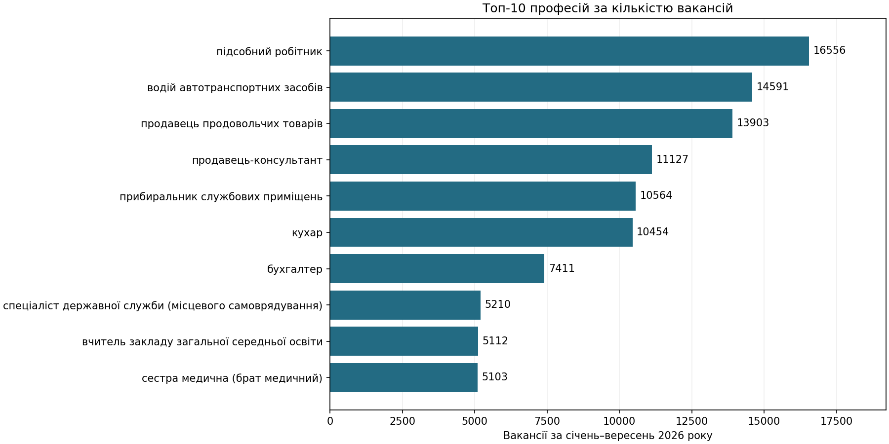
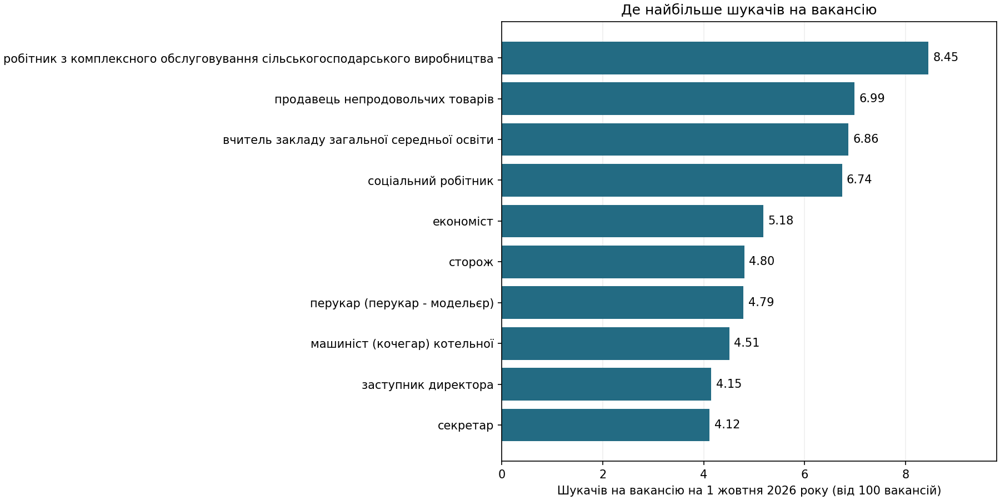
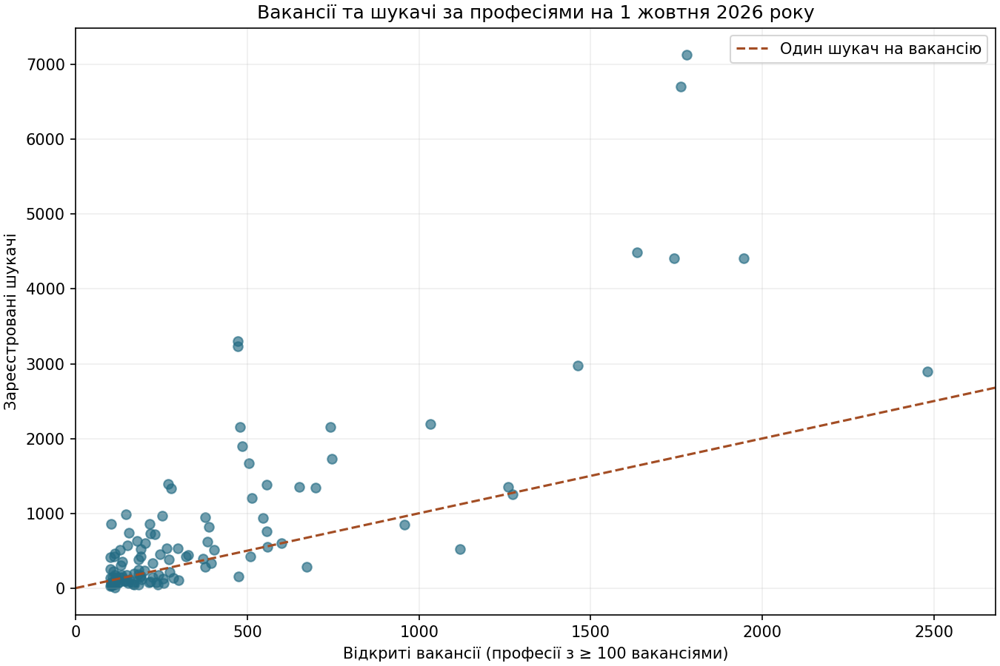

# Попит і конкуренція за професіями в Україні у 2026 році

## Мета дослідження

Я дослідила, за якими професіями роботодавці найчастіше подавали вакансії до Державної служби зайнятості та де було найбільше шукачів на одну відкриту вакансію.

1. Які професії мали найбільше вакансій за січень–вересень?
2. Де співвідношення шукачів до вакансій було найвищим станом на 1 жовтня?
3. Чи супроводжується великий попит нижчою конкуренцією?

## Дані та підготовка

Джерело — [відкритий XLSX Державної служби зайнятості](https://www.dcz.gov.ua/loaddata/upload/doc/4%20Professions%2009%202026.xlsx). З таблиці я взяла 6 080 рядків із назвами й кодами посад. Загальний підсумок, підсумки професійних груп і рядок «Особи без професії» виключено. Деякі посади мають спільний код, тому код збережено як текст, а різні назви посад залишено окремими рядками.

| Поле           | Що означає                                                              |
|--------------------|----------------------------------------------------------------------------------|
| profession         | Назва професії або посади                                  |
| code               | Код у класифікаторі професій                            |
| vacancies_jan_sep  | Вакансії, зареєстровані за дев’ять місяців |
| jobseekers_jan_sep | Зареєстровані шукачі за дев’ять місяців      |
| vacancies_oct_1    | Відкриті вакансії станом на 1 жовтня               |
| jobseekers_oct_1   | Зареєстровані шукачі станом на 1 жовтня         |

Попит я виміряла кількістю вакансій за дев’ять місяців. Для конкуренції поділила кількість шукачів на кількість відкритих вакансій **на одну дату**, 1 жовтня 2026 року. До рейтингу конкуренції включила 114 посад зі щонайменше 100 відкритими вакансіями. Цей поріг — умова аналізу, яка зменшує вплив дуже малих знаменників.

## Результати

### Найбільше вакансій за дев’ять місяців

У наборі було **349 541 вакансія за січень–вересень** і **66 906 відкритих вакансій станом на 1 жовтня**. Перші три місця за кількістю вакансій за дев’ять місяців посіли підсобний робітник (16 556), водій автотранспортних засобів (14 591) і продавець
продовольчих товарів (13 903).

### Де на вакансію припадало найбільше шукачів

Серед посад із щонайменше 100 відкритими вакансіями найвище співвідношення було в робітника з комплексного обслуговування сільськогосподарського виробництва (**8,45**), продавця непродовольчих товарів (**6,99**) і вчителя закладу загальної середньої освіти (**6,86**).

### Чим попит відрізняється від конкуренції

У водіїв і продавців продовольчих товарів кількість вакансій за дев’ять місяців була близькою. Станом на 1 жовтня у водіїв було **1,17 шукача на вакансію**, а в продавців продовольчих товарів — **4,01**. Отже, професії з подібним обсягом вакансій можуть суттєво відрізнятися за співвідношенням шукачів до відкритих вакансій.

Кожна точка на графіку — окрема посада. Вище пунктиру кількість шукачів перевищує кількість відкритих вакансій.

## Висновки й рекомендації

- Під час вибору професії варто дивитися і на кількість відкритих вакансій, і на кількість шукачів на вакансію. Для рішення про працевлаштування також важливі зарплата, вимоги та регіон.
- Перед плануванням курсів перекваліфікації варто перевірити за кілька місяців, чи зберігається низьке співвідношення шукачів до вакансій за конкретною професією в потрібному регіоні.
- Дані описують зареєстрований сегмент ринку праці. Співвідношення шукачів до вакансій є орієнтиром і може відрізнятися від фактичної кількості відгуків на оголошення.

##   

 
